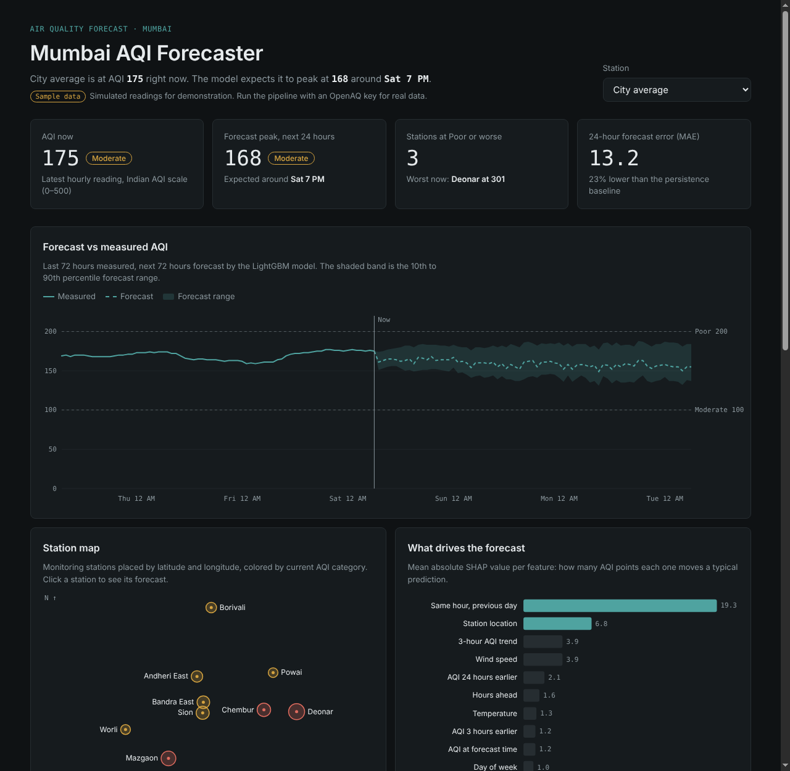

# Mumbai AQI Forecaster

Forecasts air quality for 10 Mumbai monitoring stations up to **72 hours ahead**, explains what drives each forecast, and shows it on a dashboard with health advice by area.

**Live demo:** `https://<your-username>.github.io/mumbai-aqi-forecaster/` *(after enabling GitHub Pages, see below)*



## What it does

- **Live data pipeline**: pulls hourly PM2.5 and PM10 from government monitors (CPCB / MPCB via the OpenAQ API) and weather history plus forecast from Open-Meteo.
- **Indian AQI calculation**: computes the CPCB National AQI from 24-hour average pollutant concentrations.
- **72-hour forecasting**: one LightGBM model predicts every horizon from 1 to 72 hours (direct multi-horizon), using recent AQI, the weather forecast, time of day, and festival dates.
- **Forecast range**: 10th and 90th percentile quantile models give an uncertainty band.
- **Honest evaluation**: time-based train/test split (most recent 14 days held out), compared against a persistence baseline and optionally Prophet. MAE and RMSE reported per horizon.
- **Explainability**: SHAP values show which features move the forecast most.
- **Dashboard**: station map, forecast vs measured chart, weather inputs, SHAP chart, health alerts and model comparison. Plain HTML + D3, hosted free on GitHub Pages.
- **Automated refresh**: a GitHub Actions workflow re-fetches data, retrains and redeploys every day.

## Data: sample vs live

The repo ships with **synthetic sample data** so the dashboard works immediately. The badge at the top of the dashboard says **Sample data** or **Live data**.

| Mode | Command | Data |
|---|---|---|
| Offline demo | `python -m pipeline.run_all --offline` | Simulated readings with Mumbai-like daily patterns. No API key needed. |
| Live | `python -m pipeline.run_all` | Real OpenAQ + Open-Meteo data. Needs a free OpenAQ API key. |

Note: on the synthetic data the model beats persistence at 24 hours but not at 48–72 hours, because the simulated day-to-day variation is random noise by design. Report the numbers you get on real data.

## Architecture

```
OpenAQ API ──┐
             ├─► data/raw/*.csv ─► features.py ─► train.py ─► models/ ─► predict.py ─► dashboard/data/*.csv ─► dashboard (D3)
Open-Meteo ──┘                      (lags, weather,  (LightGBM,              (72h forecast,
                                     calendar)        quantiles, SHAP)         stations, metrics)
```

| File | Purpose |
|---|---|
| `pipeline/config.py` | Stations, paths, forecast settings, festival dates |
| `pipeline/fetch_aqi.py` | Hourly PM2.5 / PM10 from OpenAQ v3 |
| `pipeline/fetch_weather.py` | Weather history + 4-day forecast from Open-Meteo |
| `pipeline/aqi.py` | CPCB AQI breakpoints, categories, health advice |
| `pipeline/features.py` | Builds (station, origin, horizon) training rows |
| `pipeline/train.py` | Baselines, LightGBM point + quantile models, metrics, SHAP |
| `pipeline/predict.py` | Live forecast and dashboard export |
| `pipeline/generate_sample.py` | Synthetic data for offline runs |
| `pipeline/run_all.py` | Runs everything in order |
| `dashboard/` | Static site: `index.html`, `style.css`, `app.js`, `data/` |

## Run it locally

```bash
git clone https://github.com/<your-username>/mumbai-aqi-forecaster.git
cd mumbai-aqi-forecaster
python -m venv .venv && source .venv/bin/activate   # Windows: .venv\Scripts\activate
pip install -r requirements.txt

# Option A: offline, synthetic data
python -m pipeline.run_all --offline

# Option B: real data
cp .env.example .env        # then paste your OpenAQ key into .env
python -m pipeline.run_all

# View the dashboard
cd dashboard && python -m http.server 8000
# open http://localhost:8000
```

Get a free OpenAQ API key at https://explore.openaq.org (sign up, then account settings).

## Deploy to GitHub Pages with daily refresh

1. Push the repo to GitHub.
2. **Settings → Secrets and variables → Actions → New repository secret**: name `OPENAQ_API_KEY`, value your key.
3. **Settings → Pages → Build and deployment → Source: GitHub Actions**.
4. **Actions → Refresh forecast and deploy → Run workflow** to run it the first time. After that it runs daily at 6:00 AM IST.

Without the secret, the workflow deploys the dashboard with whatever data is committed.

## Model details

- **Target**: CPCB AQI at time t+h, from 24-hour rolling PM2.5 / PM10 means.
- **Approach**: the model predicts the correction to the persistence forecast (same hour, previous day). Tree models can't extrapolate to AQI levels they never saw in training, but corrections stay in a stable range as pollution rises into winter.
- **Features**: AQI now and lags (1h, 3h, 24h), 6h and 24h means, 3h trend, raw PM2.5 / PM10, horizon, target hour and weekday, wind speed and direction (land vs sea breeze), humidity, temperature, festival flag, station.
- **Training**: forecast origins every 3 hours, early stopping on the last week of the training period.
- **Evaluation**: rows whose target falls in the last 14 days are held out entirely.

## Ideas to extend

- Add NO2, O3 and CO sub-indices for the full CPCB AQI
- Fetch station-level weather instead of one city point
- Add a Diwali-specific model or traffic data as a feature
- Alerts by email or Telegram when the forecast crosses Poor
- A FastAPI endpoint serving forecasts for any station

## License

MIT
